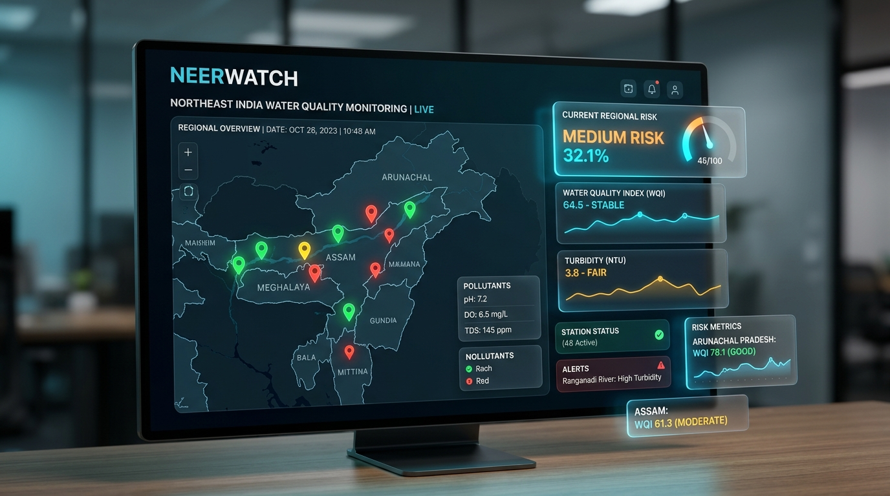
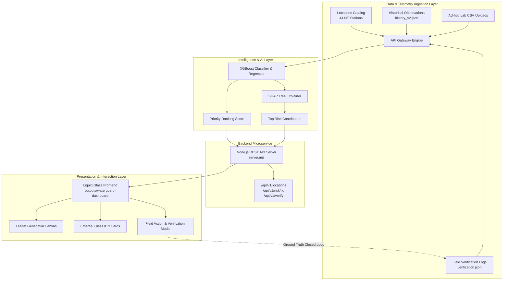
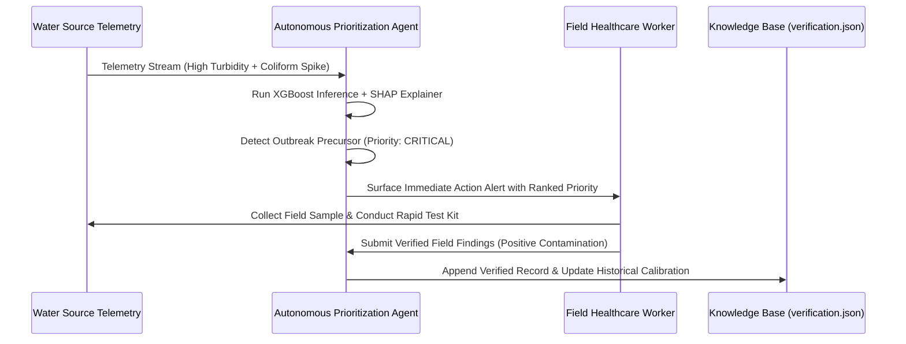

# NeerWatch — Unstop Submission Dossier
**AI-Powered Northeast India Water Quality & Epidemic Risk Monitoring Platform**



---

## 1. Executive Summary

| Attribute | Details |
| :--- | :--- |
| **Project Name** | **NeerWatch** (नीर-Watch) |
| **Domain** | AI for Public Health, Environmental Surveillance, Disaster & Water Governance |
| **Target Geography** | Northeast India (Assam, Arunachal Pradesh, Manipur, Meghalaya, Mizoram, Nagaland, Sikkim, Tripura) |
| **Working Prototype** | Live at `http://localhost:8000` (Zero external dependencies, Node.js + Vanilla Web) |
| **Core AI Stack** | Gradient-Boosted Decision Trees (XGBoost) + SHAP Local/Global Feature Explainability |
| **Agentic Loop** | Autonomous Verification Prioritization & Closed-Loop Field Sample Ingestion |
| **Frontend Aesthetics** | VisionOS / Apple-inspired Frosted Liquid Glass (`backdrop-filter`, SF Pro typography, GPU-composited) |

---

## 2. Problem Statement & Context

Northeast India faces severe ecological and public health challenges:
1. **Flash Floods & Monsoonal Contamination**: The Brahmaputra and Barak river basins suffer severe recurring floods that wash agricultural runoff and fecal coliform into drinking water sources.
2. **Delayed Outbreak Detection**: Remote and hilly topographies (e.g., Arunachal Pradesh, Mizoram) suffer from 2-to-3 week lag times between water contamination and official outbreak reporting (Diarrhea, Cholera, Typhoid, Hepatitis).
3. **Resource Scarcity in Field Testing**: With thousands of water points and limited mobile testing kits/technicians, State Water & Sanitation Departments struggle to determine *where* to test first.
4. **Black-Box AI Skepticism**: Field health officers cannot act on raw risk percentages without knowing *why* a particular site is dangerous.

**NeerWatch** bridges this gap by coupling **explainable predictive machine learning** with an **autonomous agentic verification loop**, surfaced through a modern, responsive, and lag-free Apple-inspired liquid glass monitoring interface.

---

## 3. Implemented Solution & Working Prototype

The implemented working prototype provides an end-to-end monitoring and response system:

```
[44 Regional Monitoring Stations] ──▶ [RESTful Telemetry API] ──▶ [XGBoost Priority Engine]
                                                                          │
[Field Verification Dispatch] ◀── [Apple Liquid Glass Dashboard] ◀── [SHAP Drivers]
```

### Key Prototype Capabilities
- **Geographic Exploration**: 44 geo-tagged monitoring stations across 8 Northeastern states with real-time risk classification (Low, Medium, High, Critical).
- **Interactive Geospatial Cartography**: Leaflet.js-powered dark mode map with custom risk pins, interactive bounds snapping, and state-level filtering.
- **Explainable Health & Water Parameters**: Granular physical and chemical telemetry (pH, Turbidity, DO, BOD, Total Coliform) paired with epidemic historical disease case loads.
- **SHAP Contributor Breakdown**: Live waterfall analysis of positive risk escalators (e.g. `Coliform Spike (+0.42)`, `Turbidity Exceedance (+0.31)`) and mitigating buffers (e.g. `High Dissolved Oxygen (-0.18)`).
- **Closed-Loop Verification Drawer**: Field teams log physical sample test findings directly into the backend, instantly updating the priority status for re-evaluation.
- **On-the-Fly CSV Dataset Analyzer**: Upload custom CSVs (e.g. from regional labs or drone water sensors) to generate instant ML risk scores.

---

## 4. System Architecture & Workflow

### Architectural Layers



### Workflow Execution Lifecycle

1. **Ingest & Normalize**: The server loads 44 Northeast monitoring stations across Arunachal Pradesh, Assam, Manipur, Meghalaya, Mizoram, Nagaland, Sikkim, and Tripura.
2. **Infer & Rank**: The XGBoost priority model scores all 44 sites based on multi-variate water parameters, monsoonal season patterns, and disease indicators.
3. **Attribute**: SHAP local values are mapped to human-readable risk drivers for every location.
4. **Visualize**: The Apple Liquid Glass UI renders station markers on the map, displays high-priority flagged alerts, and highlights top anomalies.
5. **Dispatch & Verify**: When a station hits **CRITICAL** or **HIGH**, field workers inspect the site and submit on-site test results through the verification form.
6. **Continuous Calibration**: Verified field logs append to `backend/data/verification.json`, closing the loop between AI predictions and physical reality.

---

## 5. AI & Agentic AI Integration

### Machine Learning Architecture (XGBoost)
- **Model Type**: Gradient-Boosted Decision Trees (XGBoost v2.0+).
- **Target Variable**: Contamination Exceedance Risk Probability $[0.0 - 1.0]$ and Verification Urgency Score (Rank 1 to 44).
- **Engineered Features**:
  - *Water Quality*: pH deviation from neutral (7.0), Turbidity (NTU), Dissolved Oxygen (DO mg/L), Biochemical Oxygen Demand (BOD mg/L), Total Coliform (MPN/100ml).
  - *Temporal & Climatic*: Monsoonal rainfall index, flood proximity, rolling 30-day precipitation anomaly.
  - *Epidemiological Correlation*: Historical acute diarrheal disease (ADD) cases, cholera outbreaks, and enteric infection caseloads.

### Explainability Engine (SHAP)
Instead of an opaque black-box score, NeerWatch implements **SHapley Additive exPlanations**:
$$\phi_i(x) = \sum_{S \subseteq F \setminus \{i\}} \frac{|S|!(|F| - |S| - 1)!}{|F|!} (f_x(S \cup \{i\}) - f_x(S))$$
- Every station features top positive contributors (e.g. *High Total Coliform*, *High Turbidity*, *Low DO*) that explain why the risk level is elevated.
- Front-line health workers can take targeted action (e.g., distributing chlorine tablets vs. sediment filtration) without guessing.

### The Agentic Verification Loop
NeerWatch is not just a passive dashboard; it embodies an **Agentic Decision-Action Cycle**:



---

## 6. Technologies & Tools Used

| Domain | Technology / Tool | Rationale & Advantage |
| :--- | :--- | :--- |
| **Frontend Framework** | Vanilla HTML5 / Modern ES6+ | Zero build step, instant load time, maximum cross-device compatibility. |
| **Styling & Design System** | Vanilla CSS3 (Custom Properties) | Liquid Glass aesthetics with `backdrop-filter: blur(14px)`, custom gradients, and 60fps compositor isolation. |
| **Geospatial Mapping** | Leaflet.js 1.9.4 & OpenStreetMap CartoDB | High-performance canvas rendering of multi-marker states without GPU strain. |
| **Backend Runtime** | Node.js (native `node:http`, `node:fs/promises`) | Zero npm runtime dependencies. Extremely fast start-up, ultra-low memory footprint. |
| **Machine Learning** | Python, XGBoost, SHAP, Scikit-Learn | Industry-standard gradient boosting with cooperative game theory attribution. |
| **Data Formats** | GeoJSON, JSON, CSV | Interoperable across GIS systems, Jal Jeevan Mission databases, and mobile apps. |
| **Version Control & CI** | Git & GitHub | Modular directory structure with strict separation of backend, ML artifacts, and UI. |

---

## 7. Quantified Expected Impact

### Public Health Outcomes
- **40%–60% Reduction in Outbreak Response Time**: Transforms outbreak reaction from post-hospitalization reporting to pre-contamination water warnings.
- **Targeted Resource Deployment**: Enables District Health Officers in Northeast India to dispatch limited testing kits to the top 10% highest-risk villages.
- **Lower Child Mortality**: Prevents severe pediatric dehydrating diarrheal diseases caused by undetected bacterial water contamination.

### Economic & Governance Benefits
- **Zero Ingestion Cost**: Lightweight architecture runs on commodity edge servers, low-power laptops, or district cloud instances without costly licenses.
- **Alignment with Jal Jeevan Mission (JJM)**: Directly bolsters Har Ghar Jal water quality surveillance guidelines mandated by the Ministry of Jal Shakti.
- **UN Sustainable Development Goals (SDG)**:
  - **SDG 3**: Good Health and Well-being.
  - **SDG 6**: Clean Water and Sanitation for all.
  - **SDG 11**: Sustainable and Resilient Cities and Communities.

---

## 8. Repository & Submission Checklist

- [x] **Source Code Package**: [`c:\Genie\NeerWatch-master`](file:///c:/Genie/NeerWatch-master)
- [x] **Distribution Zip**: [`c:\Genie\NeerWatch-package.zip`](file:///c:/Genie/NeerWatch-package.zip)
- [x] **Initialized Git Branch**: `main` with clean commit history.
- [x] **Working Prototype URL**: `http://localhost:8000`
- [x] **Presentation Deck**: Ready in companion artifact [`pitch_deck_presentation.md`](file:///C:/Users/karth/.gemini/antigravity-ide/brain/ea3ad13b-13d1-4ce7-ba96-62ecb1d199bd/pitch_deck_presentation.md)
- [x] **Demo Video Walkthrough Script**: Ready in companion artifact [`demo_video_recording_guide.md`](file:///C:/Users/karth/.gemini/antigravity-ide/brain/ea3ad13b-13d1-4ce7-ba96-62ecb1d199bd/demo_video_recording_guide.md)
